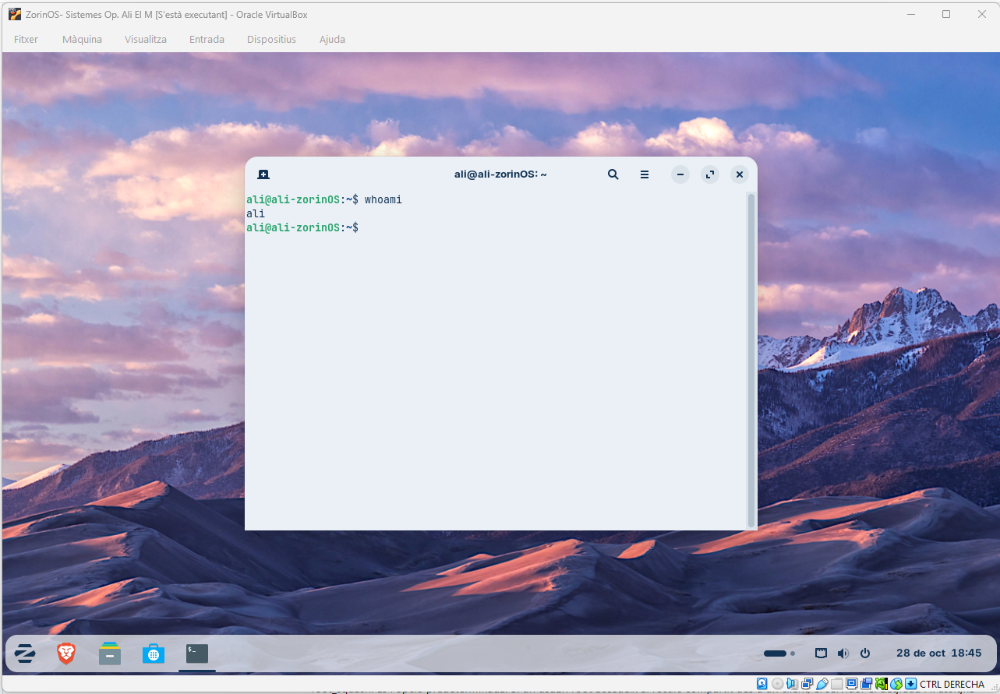
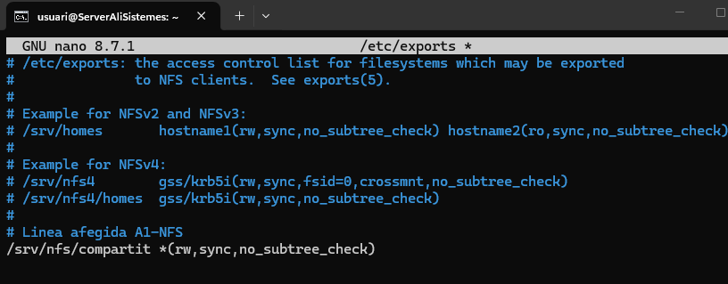
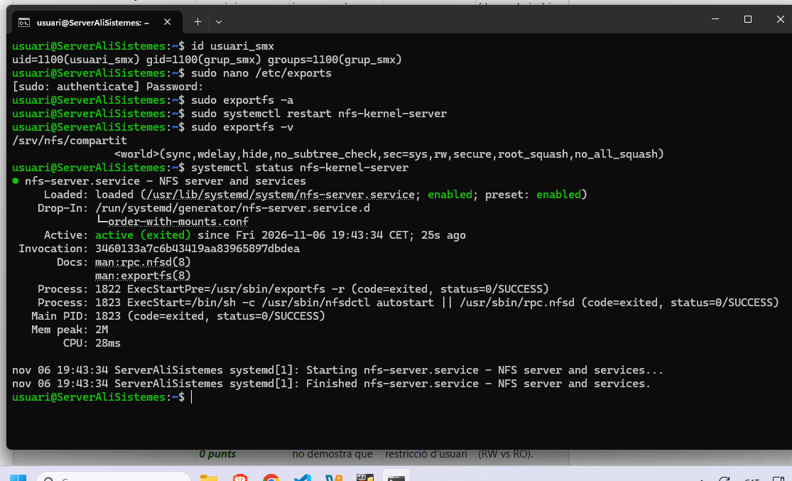

# Pràctica NFS: servidor Ubuntu i client Zorin OS

**Fet per Alí El Mssail, repositori millorat amb ajuda de la IA ``Claude``**

Compartició d'una carpeta per NFS entre un Ubuntu Server i un client Zorin OS, tots dos en màquines virtuals de VirtualBox.

---

## Fase 1: Infraestructura i Xarxa

Dues MVs (servidor Ubuntu i client Zorin OS) amb xarxa i paquets NFS instal·lats.

*Client Zorin OS creat i funcionant.*

*Servidor Ubuntu: `10.0.2.3` (NAT) i `192.168.56.103` (host-only).*

*Client Zorin OS: `10.0.2.7`.*

*Connectivitat correcta del client al servidor (0% de pèrdua).*

*Sistemes actualitzats amb `apt update`.*

*Servidor: `sudo apt install nfs-kernel-server -y`.*

*Client: `sudo apt install nfs-common -y`.*

---

## Fase 2: Usuaris, Grups, Carpetes i Permisos Locals

### 2.1 Usuaris i Grups

Es crea `grup_smx` (GID 1100) i `usuari_smx` (UID 1100) a les dues màquines perquè els IDs coincideixin.

*Client: `groupadd -g 1100` i `useradd -u 1100`.*

*Client: contrasenya assignada i accés amb `su - usuari_smx`.*

*Servidor: `id usuari_smx` retorna `uid=1100` i `gid=1100`, igual que al client.*

### 2.2 Carpetes i Permisos Locals

Es crea `/srv/nfs/compartit` al servidor (propietari `usuari_smx`, permisos `750`) i el punt de muntatge `/mnt/compartit` al client.

*Servidor: `groupadd`, `useradd`, `mkdir`, `chown` i `chmod 750` (el primer `chown` va fallar per usar un usuari inexistent i es va corregir).*

*Client: `sudo mkdir -p /mnt/compartit`.*

---

## Fase 3: Gestió de root squash

L'export manté `root_squash` actiu, de manera que el root del client es mapeja a un usuari sense privilegis.

*`/etc/exports`: `/srv/nfs/compartit *(rw,sync,no_subtree_check)`.*

*`exportfs -v` mostra `root_squash` i `no_all_squash` actius, i el servei `nfs-kernel-server` en execució.*

---

## Fase 4: Control d'Accés i IPs

El recurs s'exporta amb `rw` a tots els clients (`*`) i l'accés efectiu el controlen els permisos d'usuari/grup (UID/GID 1100).

*Client: `usuari_smx` crea `fitxer_prova.txt` a `/mnt/compartit`.*

*Servidor: el fitxer apareix a `/srv/nfs/compartit` amb propietari `usuari_smx:grup_smx`.*

---

## Fase 5: Persistència (fstab)

S'afegeix el muntatge a `/etc/fstab` perquè el recurs es munti automàticament.

*Muntatge manual previ: `mount -t nfs 10.0.2.3:/srv/nfs/compartit /mnt/compartit`.*

*Línia afegida: `10.0.2.3:/srv/nfs/compartit /mnt/compartit nfs defaults 0 0`.*

*`daemon-reload` + `mount -a`: el volum apareix muntat amb `df -h` i el contingut és visible.*

---

## Fi de la practica.

> Comentari meu no de la IA

Ha estat interesant treballar així, no sabia que es podien conectar dos arxius a una maquina tan facilment, ha costat de entendre pero s'ha aconseguit.

*Ali El Mssail*